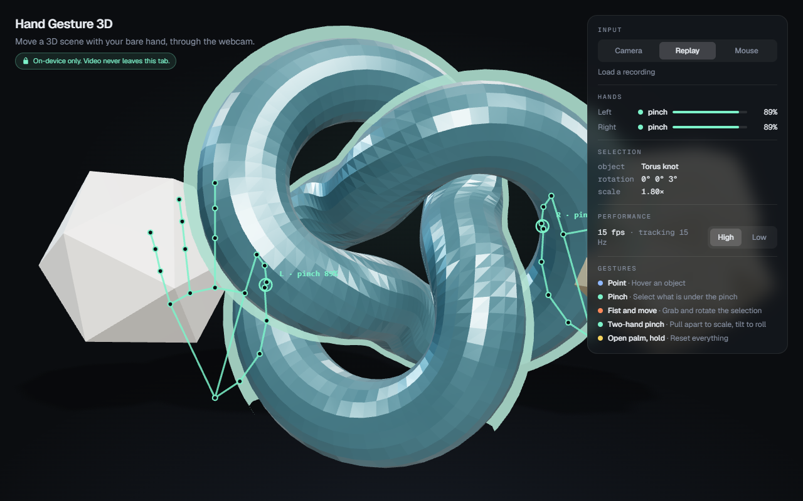
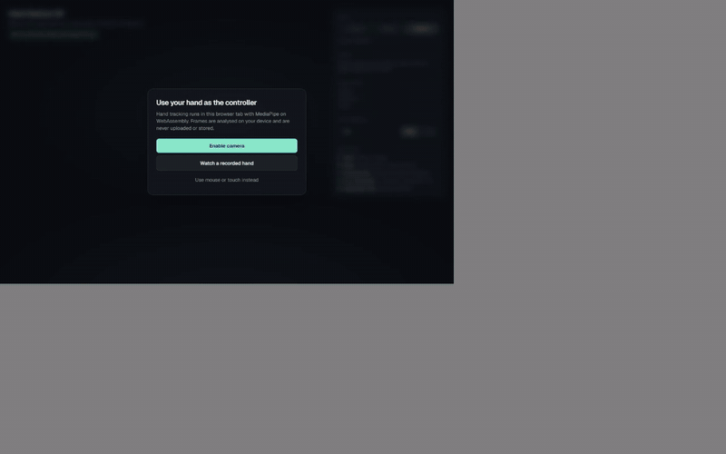
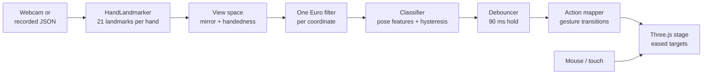

# Hand Gesture 3D

Control a 3D scene with your bare hand, through the webcam, in the browser. Point to hover, pinch to select, make a fist and move to rotate, pinch with both hands to scale, hold an open palm to reset. Hand tracking runs on your device; no video ever leaves the tab.

> Em português: controle uma cena 3D com a mão pela webcam, com todo o rastreamento rodando no próprio navegador.





The images above were captured by Playwright from the built-in **fake hand replay**, since the capture machine has no webcam. Open `/?replay=demo` to see the same thing.

## Run it

```bash
npm ci
npm run dev        # http://localhost:3000
```

Pick **Enable camera**, **Watch a recorded hand** or **Use mouse or touch instead**. The camera only opens after you ask for it.

| Script | What it does |
| --- | --- |
| `npm run lint` | ESLint (Next.js core web vitals and TypeScript rules) |
| `npm run typecheck` | Strict `tsc --noEmit` |
| `npm test` | Vitest: filter, classifier, debouncer, engine, action mapping, recordings |
| `npm run build` | Production build |
| `npm run e2e` | Playwright on desktop and phone viewports, driven by the fake hand |
| `npm run fixtures` | Regenerates the landmark fixtures in `fixtures/` |
| `npm run screenshots` | Regenerates the images in `docs/` |

## How it works



Each stage is a small module that knows nothing about the others' internals:

- `src/input/sources.ts` opens the webcam and the MediaPipe Tasks Vision `HandLandmarker` (WASM, GPU delegate with a CPU fallback), or replays a recording. Both are a `FrameSource`.
- `src/input/mediapipe-adapter.ts` converts results into **view space**: the mirrored picture people expect to see of themselves.
- `src/gesture/` is the gesture engine: plain TypeScript with no DOM, Three.js or MediaPipe imports, so it runs the same in Node tests and in the browser.
- `src/scene/stage.ts` owns the Three.js scene and only accepts `Action`s. Mouse and touch produce the very same actions, which keeps the fallback honest.
- `src/runtime.ts` ties it together in one `requestAnimationFrame` loop, outside React.

## Gestures

| Gesture | How | Action |
| --- | --- | --- |
| Point | Index straight, other fingers curled | Hover the object under the fingertip |
| Pinch | Thumb and index tips touch, other fingers relaxed | Select the object under the pinch point |
| Fist and move | All four fingers curled, then move the hand | Rotate the selected object (yaw and pitch follow the hand) |
| Two-hand pinch | Pinch with both hands, pull apart or tilt | Scale with the distance, roll with the angle between the hands |
| Open palm, hold | All fingers straight for 0.8 s | Reset every object |

Mouse and touch: drag to rotate, click or tap to select, scroll or two-finger pinch to scale and twist, double-click to reset.

## Design decisions

- **Rule-based classifier over pose features, not a learned model.** The features do not change with position, size, in-plane rotation, hand side or frame aspect ratio: finger extension is the ratio of tip-to-wrist and joint-to-wrist distances, and pinch distance is measured in hand sizes. Rules are explainable, need no training data and are cheap to test exhaustively. The tests sweep every pose across both hands, three rolls, two sizes and three aspect ratios.
- **Aspect-correct geometry.** MediaPipe normalises x and y separately, so a 16:9 frame squashes the hand horizontally. Every distance rescales x and z by the frame aspect before comparing.
- **Hysteresis and debounce are separate.** A pinch starts below 0.30 hand sizes and only ends above 0.45, so a pinch held at the edge does not chatter. On top of that, any change of gesture must hold for 90 ms, so one bad frame in the middle of a grab never drops the object.
- **A fist is not a pinch.** In a fist the thumb rests on the index too. A pinch also needs the index tip out of the palm, or another finger straight.
- **Actions fire on transitions.** A pinch selects once when it starts; a fist rotates by the hand's movement since the previous frame; reset fires once per open-palm hold. Selecting empty space keeps the current selection, so a missed pinch never loses it.
- **Two-hand mode is ordered by handedness, not by screen position.** Crossing the hands does not flip the roll angle by half a turn. When the detector labels both hands the same, they are split by wrist position.
- **Handedness is swapped on purpose.** MediaPipe labels hands as if the image were already mirrored. The raw selfie feed is not, so the adapter flips x and swaps the label in one place.
- **Gestures move targets, not transforms.** The render loop eases each object toward its target pose (frame-rate independent exponential smoothing), which hides the residual tracking noise without adding lag to the gesture logic.
- **One action vocabulary for every input.** Hands, mouse and touch all emit `hover`, `select`, `rotate`, `scale`, `roll` and `reset`. The scene cannot tell them apart.
- **Recordings are the test strategy.** "Record landmarks" in camera mode downloads a JSON file of what the tracker saw; it plays back through **Load a recording**, and the tests read fixtures with the same parser. CI uses synthetic recordings built from scripted poses with seeded noise (`fixtures/`), and a test fails if a committed fixture drifts from its definition. No camera is needed anywhere in CI.

## Performance notes

- Detection runs once per new video frame (when `video.currentTime` changes), not once per render, so a 30 fps camera on a 60 Hz screen does not cost 60 inferences a second.
- The GPU delegate is tried first and falls back to CPU if it cannot start.
- The per-frame pipeline lives outside React. React gets a status snapshot 8 times a second for the HUD, so the panel never re-renders per frame.
- The quality toggle switches pixel ratio (up to 2x versus 0.75x) and shadows.
- The WASM runtime is served from this origin (copied from `node_modules` before `dev` and `build`). The 7.8 MB model is fetched once from Google's MediaPipe model bucket and then cached by the browser.
- In headless CI the scene renders with SwiftShader (software WebGL), so the FPS shown in the screenshots is far below what a real GPU does.

## Privacy

Everything happens in your browser tab. Webcam frames go from the `<video>` element straight into the WASM hand tracker running locally; they are never uploaded, stored or sent to any server, and there is no analytics. The only network requests are for the app itself, the WASM runtime and the model file. A landmark recording only exists when you press "Record landmarks", and it is downloaded to your own machine.

## Limitations

- Verified end to end with the recorded fake hand only. Thresholds come from MediaPipe's landmark geometry, not from tuning on a dataset of real hands; a session with a real webcam and the recorder is the next step.
- On a portrait phone the landmark overlay is stretched to the screen: control over the whole screen matters more than proportions.
- No depth gestures yet: push and pull along z would need per-user calibration.

## Stack

Next.js 16 (App Router), React 19, TypeScript (strict), Tailwind CSS 4, Three.js, MediaPipe Tasks Vision, Vitest, Playwright, GitHub Actions.

## License

[MIT](LICENSE), 2026 Leonardo Carnevalli.
